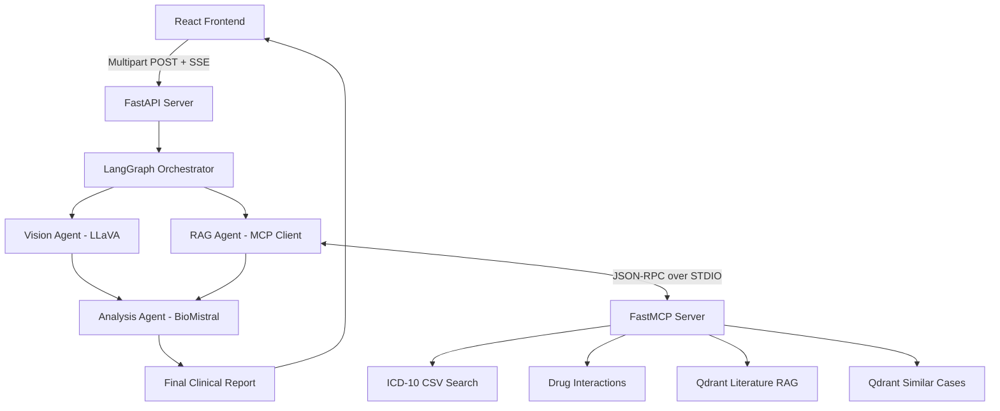

# Multimodal Clinical AI Copilot


-green)

An advanced, multimodal clinical AI assistant that analyzes chest X-rays, synthesizes patient symptoms, checks for drug interactions, and queries medical literature to generate comprehensive, structured clinical reports. Built using a fully agentic architecture with LangGraph and the Model Context Protocol (MCP).

**Note:** This is a portfolio demonstration project built for research purposes. It is **not** a real medical device and should not be used for actual clinical diagnosis.

---

## 🌟 Key Features

1. **Multimodal Vision Analysis**
   - Uses **LLaVA-Med (7B)** to extract clinical findings directly from uploaded Chest X-rays (PNG/JPG/DICOM).
2. **Agentic Orchestration (LangGraph)**
   - Uses a parallel StateGraph to route image analysis to the Vision Agent and text symptoms to the RAG Agent simultaneously, merging their outputs before final synthesis.
3. **Model Context Protocol (MCP) Client/Server**
   - Implements a decoupled tool architecture. The RAG Agent acts as an MCP Client communicating over STDIO with an isolated `fastmcp` server.
   - **Tools Exposed:** ICD-10 Coding, Medical Literature Search (Qdrant), Similar Case Retrieval (Qdrant), Drug-Drug Interaction Check.
4. **BioMedical Reasoning**
   - Uses **Mistral (7B)** as the final synthesis agent to interpret the retrieved data and vision findings into a clean Markdown clinical report.
5. **Streaming React Dashboard**
   - A premium Vanilla CSS React frontend featuring Server-Sent Events (SSE) to stream the AI's "thought process" in real-time.
6. **Automated PDF Generation**
   - Converts the final markdown report into a downloadable, medical-grade PDF using `reportlab`.

---

## 🏗️ Architecture



---

## 🚀 Getting Started

### Prerequisites
1. **Ollama**: Must be installed on your host machine to run the models locally.
   ```bash
   ollama pull llava:7b
   ollama pull mistral:7b
   ```
2. **Docker & Docker Compose**: For running the application stack.
3. **Qdrant Cloud Account**: For hosting the vector embeddings.

### 1. Environment Setup
Create a `.env` file in the `backend/` directory:
```env
QDRANT_URL=https://your-cluster-url.aws.cloud.qdrant.io
QDRANT_API_KEY=your-api-key
HUGGINGFACE_TOKEN=your-hf-token
OLLAMA_BASE_URL=http://host.docker.internal:11434
```
*(Note: If running in Docker on Windows/Mac, use `host.docker.internal` to allow the container to reach the host's Ollama instance. On Linux, use the host's IP.)*

### 2. Run the Application
The entire stack (FastAPI backend + Vite React frontend) is orchestrated via Docker Compose.

```bash
docker-compose up --build -d
```

- **Frontend UI:** `http://localhost:80`
- **Backend API:** `http://localhost:8000/docs`

### 3. Local Development without Docker
If you prefer to run the services manually:

**Terminal 1 (Backend):**
```bash
cd backend
python -m venv .venv
.\.venv\Scripts\activate
pip install -r requirements.txt
uvicorn api.main:app --reload --port 8000
```

**Terminal 2 (Frontend):**
```bash
cd frontend
npm install
npm run dev
```

---

## 🧪 Testing the Application
1. Open the UI at `http://localhost:5173` (local dev) or `http://localhost:80` (Docker).
2. Upload a sample X-Ray from `backend/data/openi/images/`.
3. Input a clinical symptom (e.g., *"Patient complains of chronic cough and shortness of breath"*).
4. Watch the LangGraph state machine stream its progress live via SSE.
5. Download the finalized PDF report!

---

## 👨‍💻 Built With
- **FastAPI** (Python 3.11)
- **LangGraph** (Stateful Agent Orchestration)
- **Model Context Protocol (MCP)** (Standardized Tool Execution)
- **Qdrant** (Vector Database)
- **Ollama** (Local LLM Inference)
- **React / Vite / TypeScript** (Frontend)
- **Vanilla CSS** (Premium Glassmorphism Design System)
