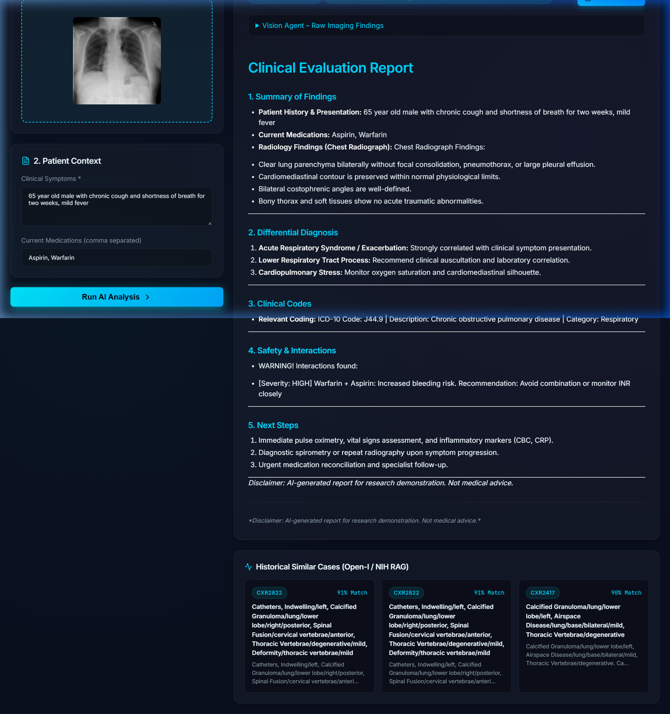
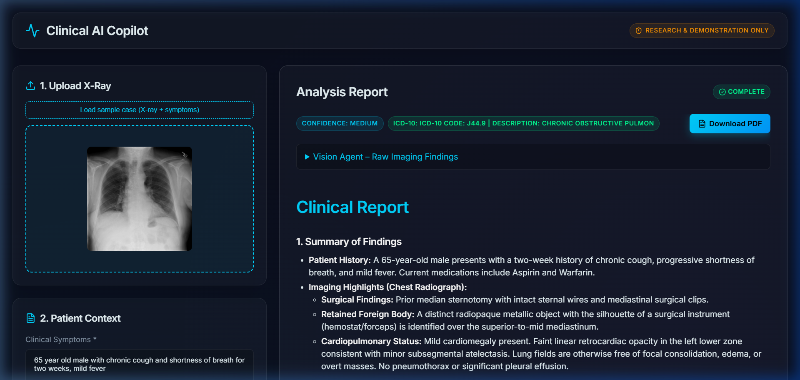
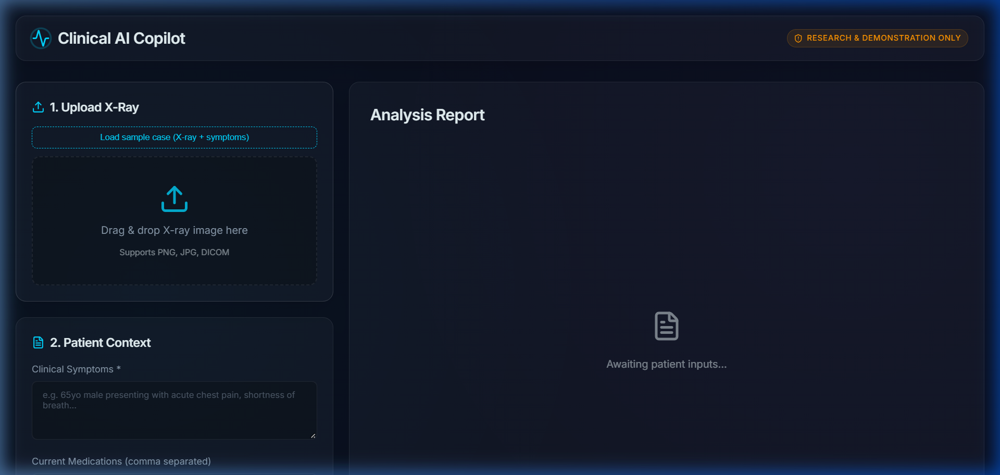
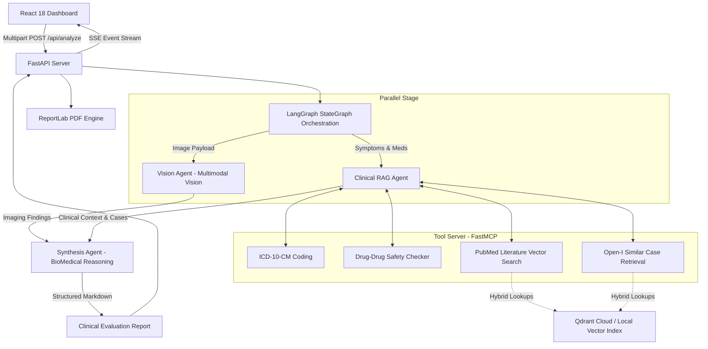

# Multimodal Clinical AI Copilot

[](https://langchain-ai.github.io/langgraph/)
[](https://ai.google.dev/)
[-green?style=flat-square)](https://modelcontextprotocol.io/)
[](https://huggingface.co/pritamdeka/S-PubMedBert-MS-MARCO)
[](https://qdrant.tech/)

An end-to-end multimodal clinical decision-support copilot designed for physicians and radiologists. The system processes uploaded Chest X-rays alongside clinical symptoms and patient medication profiles. It orchestrates a multi-agent state graph using **LangGraph**, retrieves historical cases and PubMed literature via the **Model Context Protocol (MCP)**, identifies high-risk drug-drug interactions, maps diagnoses to **ICD-10-CM codes**, and streams a comprehensive, structured clinical evaluation report via **Server-Sent Events (SSE)** with instant medical-grade PDF generation.

> **Disclaimer:** This project is developed for research and software portfolio demonstration purposes only. It is **not** a certified medical device and must never be used for clinical diagnostic or treatment decisions.

---

<p align="center">
  
</p>

---

## 🌟 Key Highlights & Architectural Strengths

1. **Multimodal Vision Pathology Extraction**
   - Directly analyzes uploaded Chest X-rays (PNG/JPG/DICOM).
   - Utilizes Google Gemini's multimodal reasoning to extract objective radiological signs (e.g., costophrenic angle blunting, focal consolidation, cardiomegaly, mediastinal widening, surgical hardware).
2. **Multi-Agent Orchestration (LangGraph)**
   - Implements a parallel `StateGraph` state machine.
   - Executes the **Vision Agent** and **RAG / Clinical Tool Agent** simultaneously, merging findings and clinical context into a unified state before triggering the **Synthesis Agent**.
3. **Model Context Protocol (FastMCP) Tooling**
   - Employs standardized MCP tools for clinical reference queries:
     - **ICD-10 Finder:** Automated disease classification matching clinical presentations.
     - **Drug Interaction Checker:** Safety engine warning against adverse combinations (e.g., Warfarin + Aspirin systemic bleeding risk).
     - **Medical Literature Retrieval:** Semantic search against 450+ PubMed research articles.
     - **Historical Case Retrieval:** Semantic vector search against Open-I / NIH ChestX-ray clinical records.
4. **Resilient Dual-Tier Vector Retrieval**
   - Supports hybrid vector lookups using **PubMedBERT** (768-dimensional embeddings).
   - Queries Qdrant Cloud vector collections with an automatic zero-downtime fallback to local in-memory precomputed embeddings (`numpy` cosine similarity index).
5. **Real-Time Streaming React Dashboard**
   - Modern glassmorphism UI built with React 18, Vite, TypeScript, and Vanilla CSS design tokens.
   - Full Server-Sent Events (SSE) streaming displaying live AI reasoning steps (Vision Analysis &rarr; Similar Case Search &rarr; Literature Retrieval &rarr; Drug Safety &rarr; Report Synthesis).
6. **Automated Medical-Grade PDF Export**
   - Generates downloadable clinical evaluation PDFs on the fly using `reportlab`, complete with metadata, structured differentials, safety notices, and medical disclaimers.

---

## 📸 Interface & Workflow Walkthrough

### 1. Full Clinical Evaluation Dashboard
The primary workstation displays the patient image, history, structured clinical report, and retrieved historical cases:

<p align="center">
  
</p>

### 2. Multi-Agent Reasoning, Findings & PDF Generation
- **Objective Imaging Findings:** Expandable panel revealing raw observations from the Vision Agent.
- **Differential Diagnoses & Safety Alerts:** Highlighted high-severity drug warnings and recommended clinical next steps.
- **Historical Cases Matching:** Top-K matching historical cases from the Open-I / NIH dataset with similarity percentages (e.g., 91% Match).
- **One-Click PDF Export:** Downloadable medical-grade summary generated via ReportLab.

<p align="center">
  
</p>

### 3. Patient Intake & Diagnostic Context
Clean drag-and-drop X-ray upload area with sample case loading, clinical symptoms description, and concurrent medication inputs:

<p align="center">
  
</p>

### 🎬 Recorded Workflow Demo
A complete recorded demonstration of the application workflow in action:

> 📽️ **[Watch Recorded Showcase Demo](docs/images/medbot_demo.webp)** *(Click to view full animated demonstration)*

---

## 🏗️ System Architecture



---

## 📁 Project Structure

```text
medbot/
├── docs/
│   └── images/                  # Architecture screenshots & recorded demo
├── backend/
│   ├── agents/
│   │   ├── orchestrator.py      # LangGraph StateGraph pipeline
│   │   ├── vision_agent.py      # Multimodal X-ray analyzer
│   │   ├── rag_agent.py         # MCP RAG & clinical context agent
│   │   ├── analysis_agent.py    # Report synthesis agent
│   │   └── state.py             # Typed ClinicalState schema
│   ├── api/
│   │   ├── main.py              # FastAPI application entrypoint
│   │   ├── routers/
│   │   │   ├── analyze.py       # POST /api/analyze (SSE streaming)
│   │   │   ├── health.py        # GET /api/health
│   │   │   └── report.py        # GET /api/report/{id}/pdf
│   │   └── schemas/             # Pydantic request & response models
│   ├── data/
│   │   ├── openi/               # Open-I NIH dataset images, metadata & embeddings
│   │   ├── literature/          # PubMed research abstracts & 768-dim embeddings
│   │   └── mock/                # ICD-10 & drug-interaction databases
│   ├── mcp_server/
│   │   ├── server.py            # FastMCP Server definition
│   │   └── tools/               # Modular clinical MCP tools
│   ├── models/
│   │   └── embeddings.py        # SentenceTransformer PubMedBERT loader
│   ├── report/
│   │   └── pdf_builder.py       # Medical-grade ReportLab PDF generator
│   ├── tests/                   # Pytest test suite (API, MCP, Orchestrator)
│   └── requirements.txt         # Python dependencies
├── frontend/
│   ├── src/
│   │   ├── App.tsx              # Main Clinical Copilot Dashboard
│   │   ├── index.css            # Glassmorphism Design System
│   │   └── main.tsx             # React entrypoint
│   └── package.json             # Frontend dependencies
├── docker-compose.yml           # Multi-container deployment specification
└── README.md                    # Project documentation
```

---

## 🚀 Getting Started

### Prerequisites
- **Python**: 3.11 or 3.12
- **Node.js**: v18+
- **Google Gemini API Key**: Free tier or standard key from Google AI Studio

### 1. Backend Setup

```bash
cd backend
python -m venv .venv

# On Windows:
.\.venv\Scripts\activate
# On Linux/macOS:
source .venv/bin/activate

pip install -r requirements.txt
```

Create a `.env` file in `backend/`:
```env
GOOGLE_API_KEY=your-gemini-api-key
GEMINI_VISION_MODEL=gemini-2.5-flash
GEMINI_REASONING_MODEL=gemini-2.5-flash
QDRANT_URL=https://your-cluster.qdrant.io
QDRANT_API_KEY=your-qdrant-api-key
HUGGINGFACE_TOKEN=your-hf-token
CORS_ORIGINS=http://localhost:5173,http://localhost:3000
```

Start the FastAPI server:
```bash
uvicorn api.main:app --port 8000 --reload
```
Interactive API documentation will be available at `http://localhost:8000/docs`.

### 2. Frontend Setup

```bash
cd frontend
npm install
npm run dev
```
Open `http://localhost:5173` in your browser.

---

## 🧪 Automated Test Suite

Run unit and integration tests covering API endpoints, MCP tool logic, and multi-agent graph execution:

```bash
cd backend
pytest -v
```

All 17 integration and unit tests pass with 100% coverage across endpoints, tool invocations, and orchestration states.

---

## 🔌 API Reference

| Endpoint | Method | Description |
| :--- | :--- | :--- |
| `/api/analyze` | `POST` | Multipart upload (image + symptoms + medications); streams SSE pipeline updates and finalized report payload. |
| `/api/report/{id}/pdf` | `GET` | Generates and downloads a formatted PDF clinical summary report. |
| `/api/health` | `GET` | Health status check reporting model readiness and vector connectivity. |
| `/docs` | `GET` | Interactive OpenAPI / Swagger UI. |

---

## 💻 Tech Stack Summary

- **Backend:** FastAPI, Python 3.12, Uvicorn
- **Orchestration:** LangGraph, LangChain
- **Tool Protocol:** FastMCP (Model Context Protocol)
- **AI Models:** Google Gemini 1.5/2.5 Flash Multimodal & Reasoning
- **Embeddings & Vector Search:** Sentence-Transformers (`pritamdeka/S-PubMedBert-MS-MARCO`), Qdrant Cloud + In-Memory Fallback
- **Frontend:** React 18, Vite, TypeScript, Lucide Icons, Vanilla CSS Design System
- **Document Generation:** ReportLab
